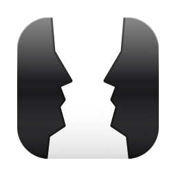
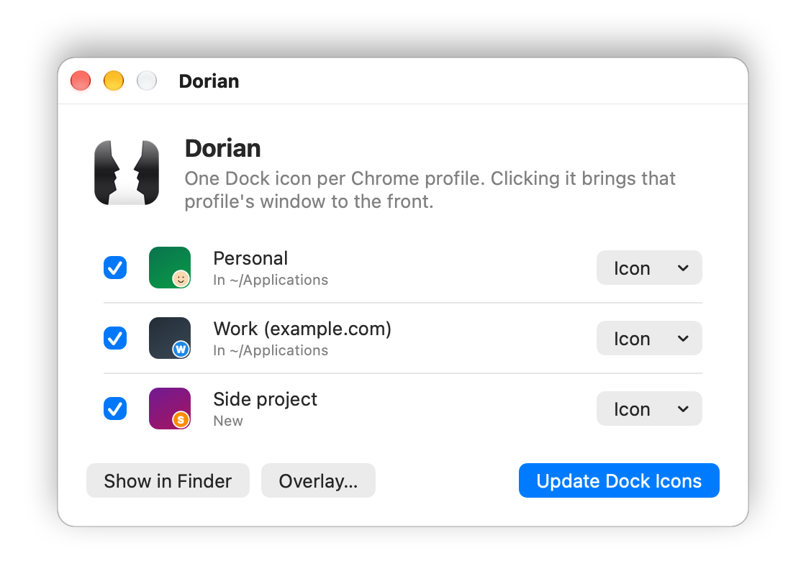
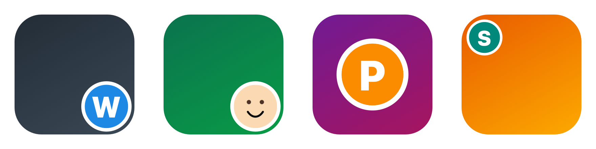

<p align="center">
  
</p>

<h1 align="center">Dorian</h1>

<p align="center">
  <b>One Dock icon per Chrome profile.</b><br>
  Click it and that profile's window comes to the front. No duplicate windows, no second Chrome.
</p>

<p align="center">
  
  
  
  
</p>

---

If you keep work and personal life in separate Chrome profiles, you know the dance: find the right window, or open
the Profiles menu and pick one. Shortcuts that start Chrome with `--profile-directory` always open a *new* window,
and separate Chrome copies with their own `--user-data-dir` break sync and updates.

Dorian gives each profile its own app in the Dock. Click it and Dorian presses that profile in Chrome's own
**Profiles** menu, which is exactly what you'd do by hand. Chrome brings that profile's existing window to the front,
and opens a window only if the profile has none. Chrome stays your normal, single install.

<p align="center">
  <picture>
    <source media="(prefers-color-scheme: dark)" srcset="docs/setup-dark.png">
    
  </picture>
</p>

## Features

- **Focuses, doesn't duplicate.** Clicking a profile's icon brings its existing window forward.
- **Automatic.** Dorian reads your profiles from Chrome; there's nothing to configure.
- **Your icons.** Each icon is Chrome's icon from your own install, or an image you pick, with an overlay: a
  coloured letter, a picture, or nothing. You choose the overlay's position and size.
- **Full size in the Dock.** Icons follow Apple's icon grid, so macOS doesn't shrink them into a gray box.
- **Any language.** Dorian finds the Profiles menu by its layout, not its title.
- **Tiny and private.** Native Swift, no dependencies, no network access, no data collected.

## Install

You need an Apple Silicon Mac with macOS 13 or later, and the Xcode Command Line Tools
(`xcode-select --install`). Dorian is built from source on your Mac:

```sh
git clone https://github.com/JohanBellander/Dorian.git
cd Dorian
./build.sh
```

This builds `Dorian.app` and installs it in `~/Applications`.

## Set up

1. Open **Dorian** from `~/Applications`.
2. Click **Grant Access…** and switch Dorian on under System Settings → Privacy & Security → Accessibility.
   Only Dorian needs this; the Dock icons don't. (Don't add it with "+", see [Troubleshooting](#troubleshooting).)
3. With Chrome running, Dorian lists your profiles. Pick the ones you want and click **Create Dock Icons**.
4. Drag the new `Chrome - <Profile>` apps from the Finder window that opens to your Dock.

### Customise the icons

<p align="center">
  
</p>

- **Icon → Overlay:** a coloured letter (the default), a **Picture…** you choose, or **None**.
- **Icon → Background:** Chrome's icon (the default), or an **Image…** you choose.
- **Overlay…** sets the position (a corner or the center) and size for all icons, with a live preview.

Click **Update Dock Icons** to apply changes. Dorian can't use Chrome's own profile pictures, because macOS doesn't let
other apps read Chrome's data. Use **Picture…** for that.

### When your profiles change

Open Dorian and click **Update Dock Icons**: new profiles get an icon, and icons for removed profiles are deleted.
Profiles you switched off stay off. Dorian only ever deletes apps it created, and only after it has read Chrome's
Profiles menu, so nothing is removed while Chrome is closed.

## How it works

```
Dock icon ──dorian://switch?profile=Work──▶ Dorian ──Accessibility──▶ Chrome ▸ Profiles ▸ Work
```

- A Dock icon is a tiny app (under 300 KB, mostly its icon) that opens a `dorian://` link and quits. It needs no permissions.
- Dorian starts Chrome if it isn't running, presses the profile in the Profiles menu, and quits again.
- Errors are shown in a dialog and written to `~/Library/Logs/Dorian.log`.

## Troubleshooting

**Dorian is on in the Accessibility list but still asks for access.** You probably added it with "+". That creates
an entry by file path, but macOS checks Dorian by its bundle ID. Remove the entry with "–", quit and reopen System
Settings, then click **Grant Access…** in Dorian and switch on the entry that appears.

**Access is lost after rebuilding.** Without a certificate, `build.sh` signs ad-hoc, and macOS ties the approval to
that exact build. Rebuilding unchanged code keeps it; after a change, `build.sh` clears the old approval and you grant
access again. To keep it across rebuilds, sign with a certificate: a free Apple ID in Xcode → Settings → Accounts
gives you an "Apple Development" certificate, which `build.sh` finds on its own.

**The new version doesn't show.** If Dorian was open while you rebuilt, it still runs the old code. Quit it (⌘Q)
and open it again; `build.sh` reminds you.

**"Couldn't find Chrome's Profiles menu".** If a future Chrome changes the menu, tell Dorian its title:
`defaults write io.github.johanbellander.dorian ProfilesMenuTitle "Profiles"`, and please open an issue.

Two profiles whose names differ only in `/` or `:` would share an app name. Dorian marks them and asks you to rename
one in Chrome.

## Build options

| Variable | Default | Meaning |
| --- | --- | --- |
| `DORIAN_BUNDLE_ID` | `io.github.johanbellander.dorian` | Bundle ID of Dorian; Dock icons use `<id>.launcher.<profile>` |
| `SIGN_IDENTITY` | first "Apple Development" identity, else ad-hoc | Code-signing identity |
| `DEST` | `~/Applications` | Where `Dorian.app` is installed |

The app icon is `Resources/AppIcon.svg`; `build.sh` turns it into `AppIcon.icns`.

## Contributing

Issues and pull requests are welcome. When reporting a bug, please include your macOS and Chrome versions and the
relevant lines from `~/Library/Logs/Dorian.log`. [`AGENTS.md`](AGENTS.md) describes the design and the pitfalls.

## License

[MIT](LICENSE). Google Chrome is a trademark of Google LLC. Dorian is an independent project, not affiliated with or
endorsed by Google, and ships no Google artwork.
